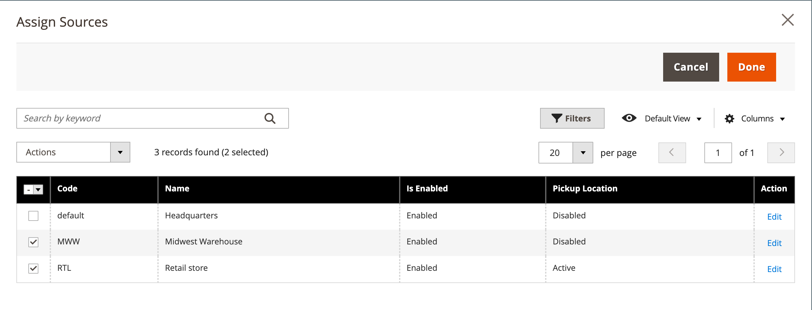
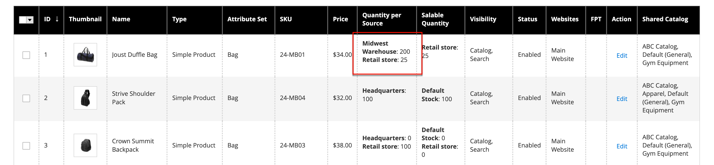

# Stock - Affecter des sources et des quantités

Pour les commerçants multisources utilisant [[!DNL Inventory Management]](../inventory-management/introduction.md), faites défiler l’écran jusqu’à la section **Sources** et attribuez les sources et les quantités :

1. Pour ajouter une source, cliquez sur **[!UICONTROL Assign Sources]**.

1. Recherchez ou recherchez des sources et cochez la case en regard des sources à ajouter au produit.

   {width="600" zoomable="yes"}

1. Cliquez sur **[!UICONTROL Done]** pour ajouter les sources.

1. Pour gérer la quantité et le statut de la source, cliquez sur **[!UICONTROL Advanced Inventory]** et définissez **[!UICONTROL Manage Stock]** sur `Yes`.

1. Définissez **[!UICONTROL Source Item Status]** sur `In Stock`.

1. Saisissez un montant pour mettre à jour le **[!UICONTROL Qty]** du stock disponible.

1. Pour définir une notification pour les quantités en stock, effectuez l&#39;une des opérations suivantes :

   - _Quantité de notification personnalisée_ - Décochez la case **[!UICONTROL Notify Quantity Use Default]** et saisissez un montant en **[!UICONTROL Notify Quantity]**.

   - _Quantité de notification par défaut_ - Cochez la case **[!UICONTROL Notify Quantity Use Default]**. Commerce vérifie et utilise le paramètre dans la configuration de magasin [!UICONTROL Advanced Inventory] ou globale.

   {width="600" zoomable="yes"}
