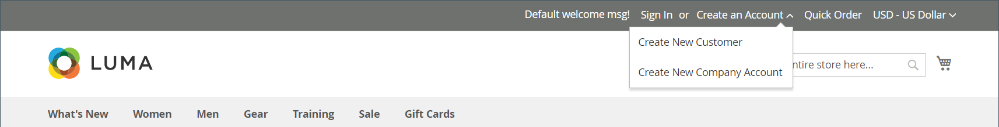
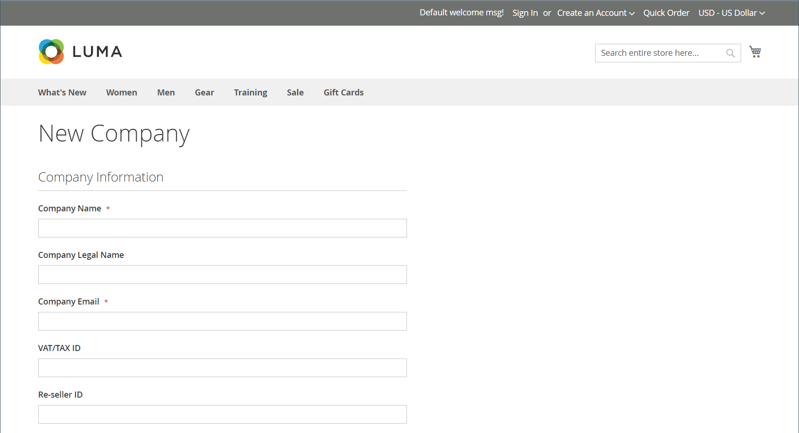
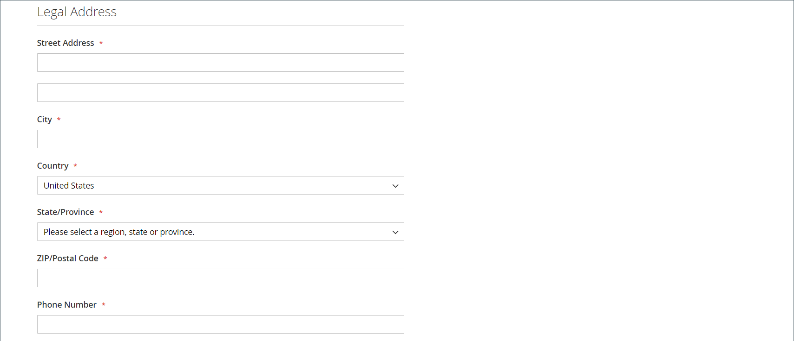
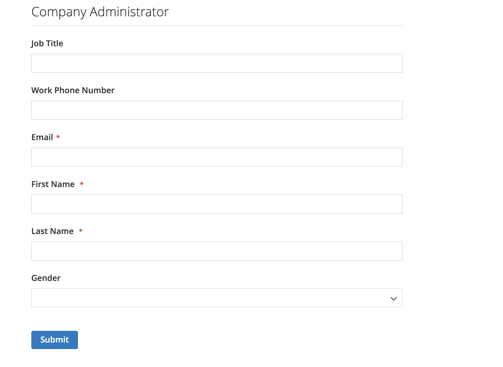
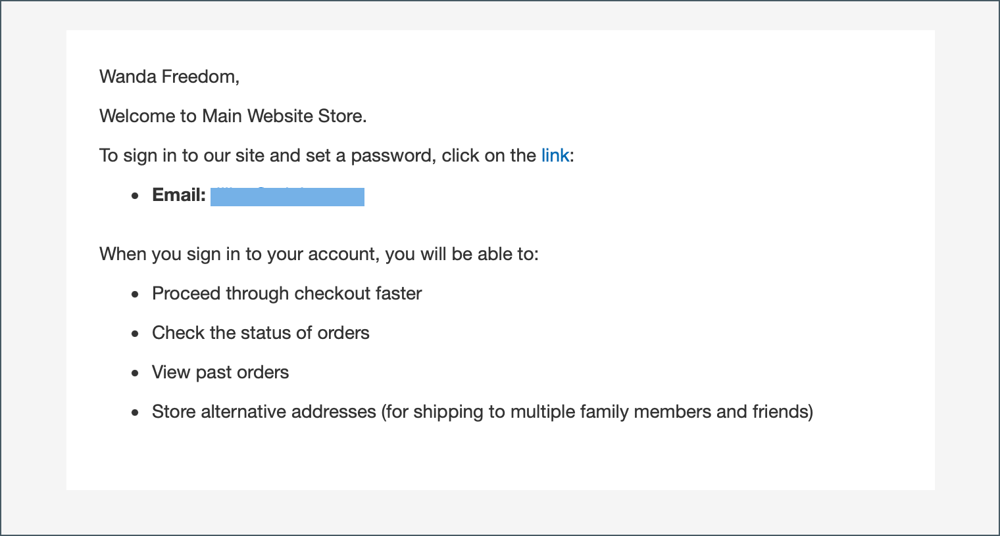
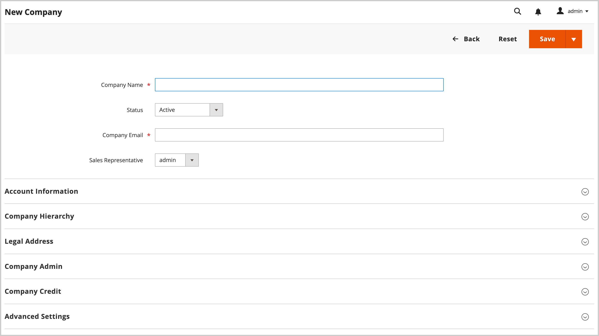
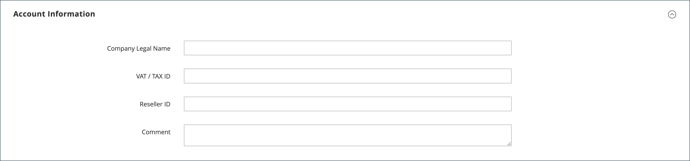
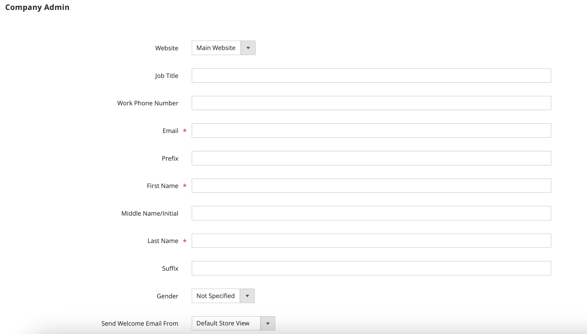
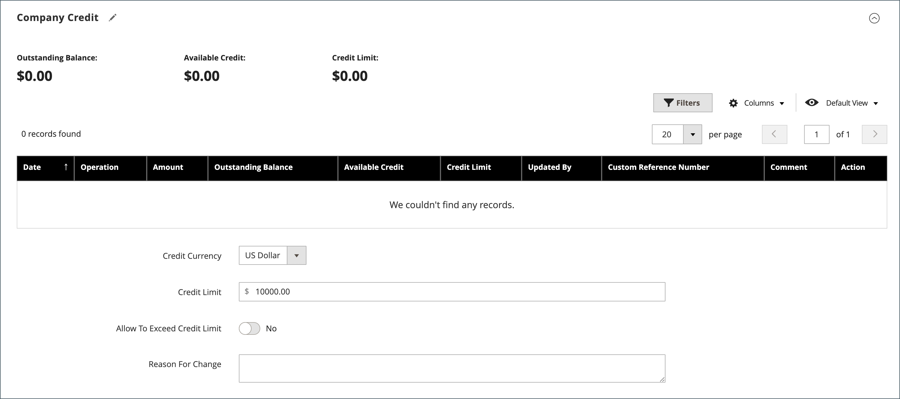
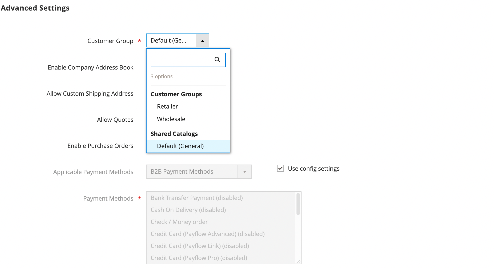

# Créer un compte d’entreprise

Les comptes d’entreprise permettent aux entreprises B2B de gérer leurs achats, leurs utilisateurs et leur crédit dans Adobe Commerce. Cette rubrique couvre l’ensemble du processus de création, de configuration et d’activation des comptes d’entreprise.

## Présentation de la création du compte d’entreprise

Les comptes d’entreprise peuvent être créés par le biais de deux méthodes, chacune adaptée à différents scénarios commerciaux :

* **Enregistrement du storefront** : demandes de compte en libre-service par des entreprises
* **Création admin**—Configuration de compte assistée par les ventes avec détails préconfigurés

Tous les comptes d’entreprise nécessitent l’approbation de l’administrateur avant de devenir actifs, assurant un contrôle et une configuration appropriés.

## Conditions préalables

Avant de créer des comptes d’entreprise, assurez-vous que les conditions suivantes sont remplies :

* **Configuration Requise :**
  * Les fonctionnalités [B2B sont activées](enable-basic-features.md) dans votre installation Adobe Commerce
  * L’enregistrement d’entreprise est activé pour la création de storefront
  * Les notifications par e-mail sont configurées pour les workflows d’approbation

* **Exigences Commerciales :**
  * Des processus et des politiques d’approbation sont établis.
  * Des représentants commerciaux sont affectés (pour les comptes créés par l’administrateur)
  * Les politiques de crédit sont définies (si vous utilisez le crédit d’entreprise).
  * Les groupes de clients et les catalogues partagés sont configurés

* **Accès Administratif :**
  * Autorisations appropriées pour la gestion de l’entreprise
  * Accès aux sections d’administration des clients et des sociétés

Le système attribue le rôle [administrateur d&#39;entreprise](account-company-admin.md) à la personne qui a configuré un compte d&#39;entreprise à partir du storefront. Une fois que l’administrateur du magasin a approuvé la demande de création de compte d’entreprise dans l’Administration, il peut définir un mot de passe de compte et se connecter au compte.

## Méthode 1 : le client crée le compte à partir du storefront

**Quand utiliser cette méthode :**

* L’enregistrement des entreprises en libre-service est préférable
* Les clients disposent de toutes les informations commerciales nécessaires
* Le workflow d’approbation standard est suffisant
* Aucune configuration ou prépopulation spéciale n’est requise

>[!IMPORTANT]
>
>Pour prendre en charge cette méthode (qui permet aux clients d’enregistrer leur société sur le storefront), assurez-vous que les [Fonctionnalités B2B](enable-basic-features.md) sont activées.

Pour les storefronts qui utilisent la mutation GraphQL `createCompany`, les paramètres du carnet d’adresses de la société peuvent être envoyés lors de l’enregistrement lorsque **[!UICONTROL Allow Company Configuration on Storefront Registration]** est activé dans [la configuration de la société](../configuration-reference/customers/company-configuration.md#general). Ce paramètre est désactivé par défaut et n’active pas lui-même le carnet d’adresses d’une entreprise.

1. Dans le coin supérieur droit de l’en-tête du storefront, le client clique sur **[!UICONTROL Create an Account]** et sélectionne **[!UICONTROL Create New Company Account]**.

   {width="700" zoomable="yes"}

   >[!NOTE]
   >
   >Si un visiteur est connecté à un compte utilisateur enregistré, il peut créer un compte d’entreprise en accédant à _[!UICONTROL Customer Profile]_>**[!UICONTROL Company Structure]**>**[!UICONTROL Create a Company Account]**.

1. Dans la section _[!UICONTROL Company Information]_, le client effectue les opérations suivantes :

   * Complète les champs obligatoires :

     * **[!UICONTROL Company Name]**
     * **[!UICONTROL Company Email]**

   * Renseigne les champs restants, le cas échéant :

     * **[!UICONTROL Company Legal Name]**
     * **[!UICONTROL VAT/TAX ID]**
     * **[!UICONTROL Reseller ID]**

   {width="700" zoomable="yes"}

1. Complète les champs obligatoires de la section _[!UICONTROL Legal Address]_.

   * **[!UICONTROL Street Address]**
   * **[!UICONTROL City]**
   * **[!UICONTROL Country]**
   * **[!UICONTROL State/Province]**
   * **[!UICONTROL ZIP/Postal Code]**
   * **[!UICONTROL Phone Number]**

   {width="700" zoomable="yes"}

1. Dans la section _[!UICONTROL Company Administrator]_, effectue les opérations suivantes :

   * Saisit le **[!UICONTROL Email address]** pour l’administrateur de la société.

     L’adresse e-mail de l’administrateur de la société peut être identique à celle de la société ou différente. Si vous saisissez une adresse e-mail différente, le système crée un compte utilisateur d’entreprise en plus du compte administrateur de l’entreprise.

   * Entre les valeurs **[!UICONTROL First Name]** et **[!UICONTROL Last Name]** de l’administrateur de la société.

   * Renseigne éventuellement les champs suivants :

     * **[!UICONTROL Job Title]**
     * **[!UICONTROL Work Phone Number]**
     * **[!UICONTROL Gender]**

   

1. Termine la validation si reCAPTCHA est activé pour cette fonction de storefront.

1. Une fois les informations renseignées, sélectionnez **[!UICONTROL Submit]**.

   Lorsque le commerçant approuve la demande de création d’un compte d’entreprise, le système envoie une notification par e-mail à l’administrateur de l’entreprise.

   {width="500"}

   Lorsque le mot de passe est défini, l&#39;administrateur de la société peut [se connecter](../customers/customer-sign-in.md) au compte.

## Méthode 2 : le commerçant crée le compte à partir de l’administrateur

**Quand utiliser cette méthode :**

* La création de compte assistée par les ventes est préférable
* Pré-remplissage des détails du compte à partir des relations commerciales existantes
* Configuration personnalisée requise (limites de crédit, tarifs spéciaux)
* Une activation immédiate sans validation du workflow est nécessaire

Le processus de création d’une entreprise à partir de l’administration est essentiellement le même que celui du storefront, mais avec des champs supplémentaires.

{width="700" zoomable="yes"}

1. Dans la barre latérale _Admin_, accédez à **[!UICONTROL Customers]** > **[!UICONTROL Companies]**.

1. Cliquez sur **[!UICONTROL Add New Company]** et procédez comme suit :

   * Renseignez les champs obligatoires suivants :

     * **[!UICONTROL Company Name]**
     * **[!UICONTROL Company Email]**

   * Si vous n’êtes pas prêt pour la mise en ligne du compte, définissez **[!UICONTROL Status]** sur `Pending Approval`. (Définissez sur `Active` par défaut.)

   * Le cas échéant, sélectionnez le compte administrateur du **[!UICONTROL Sales Representative]** chargé de gérer le compte.

1. Dans la section _[!UICONTROL Account Information]_, procédez comme suit :

   * Renseignez les champs suivants le cas échéant :

     * **[!UICONTROL Company Legal Name]**
     * **[!UICONTROL VAT/TAX ID]**
     * **[!UICONTROL Reseller ID]**

   * Pour **[!UICONTROL Comment]**, saisissez toutes les informations supplémentaires sur le client qui pourraient être nécessaires.

     Les commentaires ne sont visibles qu’à partir de l’administrateur.

   {width="700" zoomable="yes"}

1. Lorsque vous créez initialement une entreprise, la grille _[!UICONTROL Company Hierarchy]_apparaît vide lorsque vous la développez. Après avoir enregistré la société, vous pouvez l’inclure dans une hiérarchie de société. Voir [Gestion des entreprises](manage-companies.md).

1. Dans la section _[!UICONTROL Legal Address]_, renseignez les champs obligatoires suivants :

   * **[!UICONTROL Street Address]**
   * **[!UICONTROL City]**
   * **[!UICONTROL Country]**
   * **[!UICONTROL ZIP/Postal Code]**
   * **[!UICONTROL Phone Number]**

1. Dans la section _[!UICONTROL Company Admin]_, procédez comme suit :

   * Renseignez les champs obligatoires suivants :

     * **[!UICONTROL Email]**
     * **[!UICONTROL First Name]**
     * **[!UICONTROL Last Name]**

   * Renseignez les parties facultatives suivantes du nom, qui peuvent s’appliquer à certains noms de clients plus qu’à d’autres et qui peuvent être utilisées à votre discrétion :

     * **[!UICONTROL Prefix]**
     * **[!UICONTROL Middle Name/Initial]**
     * **[!UICONTROL Suffix]**

   * Si les informations sont disponibles, renseignez les champs restants pour décrire l&#39;administrateur de la société :

     * **[!UICONTROL Website]**
     * **[!UICONTROL Job Title]**
     * **[!UICONTROL Work Phone Number]**
     * **[!UICONTROL Gender]**
     * **[!UICONTROL Send Welcome Email From]**

   {width="700" zoomable="yes"}

1. Dans la section _[!UICONTROL Company Credit]_, qui affiche un résumé de l&#39;activité de crédit du client, renseignez autant de champs que nécessaire dans la partie inférieure de la section :

   * **[!UICONTROL Credit Currency]**
   * **[!UICONTROL Credit Limit]**
   * **[!UICONTROL Allow to Exceed Credit Limit]**
   * **[!UICONTROL Reason for Change]**

   {width="700" zoomable="yes"}

1. Dans la section _[!UICONTROL Advanced Settings]_, procédez comme suit :

   >[!NOTE]
   >
   >L’affectation de groupe client détermine le catalogue partagé disponible pour la société et ses employés. Par défaut, le système affecte la société au groupe de clients configuré par défaut.

   * Vous pouvez modifier l&#39;affectation **[!UICONTROL Customer Group]** de l&#39;entreprise et de ses employés à un groupe ayant accès à un autre catalogue partagé ou à un groupe de clients standard. Le système vous invite à confirmer avant de modifier le groupe.

     {width="600"}

   * Si vous souhaitez autoriser les employés de l&#39;entreprise à générer des devis à partir de leur compte, définissez **[!UICONTROL Allow Quotes]** sur `Yes`.

   * Si vous souhaitez autoriser les employés de la société à créer et utiliser des commandes fournisseur à partir de leur compte, définissez **[!UICONTROL Enable Purchase Orders]** sur `Yes`.

   * Pour activer un carnet d&#39;adresses d&#39;entreprise partagé, définissez **[!UICONTROL Enable Company Address Book]** sur `Yes`. Ce paramètre est `No` par défaut.

   * Pour autoriser une adresse d&#39;expédition temporaire au passage en caisse lorsque le carnet d&#39;adresses de la société est activé, définissez **[!UICONTROL Allow Custom Shipping Address]** sur `Yes`. Ce paramètre est `No` par défaut.

   * Pour modifier les **[!UICONTROL Applicable Payment Methods]** disponibles pour l’entreprise, décochez la case **[!UICONTROL Use config settings]** et choisissez l’une des options suivantes :

     | Option | Description |
     |-------------------------------|-----------------------------------------------------------------------------------------------------------------------------------------------------------------------------------------------------------------------------------------|
     | `B2B Payment Methods` | (Par défaut) Active tous les [modes de paiement définis comme par défaut](../configuration-reference/general/b2b-features.md#default-b2b-payment-methods) pour les commandes B2B. |
     | `All Enabled Payment Methods` | Met à disposition tous les [modes de paiement activés](../configuration-reference/sales/payment-methods.md) pour les comptes clients associés au compte d&#39;entreprise. |
     | `Selected Payment Methods` | Permet de sélectionner les modes de paiement disponibles pour les comptes client associés au compte société. Pour sélectionner plusieurs modes de paiement, maintenez la touche Ctrl (PC) ou Commande (Mac) enfoncée et sélectionnez chaque option. |

     {style="table-layout:auto"}

   * Pour modifier les **[!UICONTROL Applicable Shipping Methods]** disponibles pour l’entreprise, décochez la case **[!UICONTROL Use config settings]** et choisissez l’une des options suivantes :

     | Option | Description |
     |--------------------------------|----------------------------------------------------------------------------------------------------------------------------------------------------------------------------------------------------------------------------------------------------|
     | `B2B Shipping Methods` | (Par défaut) Active toutes les [méthodes d&#39;expédition définies par défaut](../configuration-reference/general/b2b-features.md#default-b2b-shipping-methods) pour les commandes B2B. |
     | `All Enabled Shipping Methods` | Met à disposition tous les [modes d&#39;expédition activés](../configuration-reference/sales/delivery-methods.md) pour les comptes client associés au compte d&#39;entreprise. |
     | `Selected Shipping Methods` | Permet de sélectionner les modes d&#39;expédition disponibles pour les comptes client associés au compte société. Pour sélectionner plusieurs modes d&#39;expédition, maintenez la touche Ctrl (PC) ou Commande (Mac) enfoncée et sélectionnez chaque option. |

     {style="table-layout:auto"}

1. Lorsque vous avez terminé, sélectionnez **[!UICONTROL Save]**.

   Lorsque la demande de création d’un compte d’entreprise est approuvée par le commerçant, un e-mail de notification est envoyé à l’adresse e-mail de l’administrateur de l’entreprise.

   Lorsque le mot de passe est défini, l&#39;administrateur de la société peut [se connecter](../customers/customer-sign-in.md) au compte.

## Après la création du compte

Une fois le compte d’entreprise créé, le processus suivant se produit :

### &#x200B;1. Workflow d’approbation

* **Statut en attente**—Les nouveaux comptes attendent l&#39;examen de l&#39;administrateur
* **Processus de révision** : les administrateurs de magasin vérifient les informations de l’entreprise et approuvent/rejettent les demandes
* **Mises à jour de statut**—Les entreprises reçoivent des notifications par e-mail concernant les changements de statut d&#39;approbation

### &#x200B;2. Activation de compte

* **E-mail de bienvenue** : les administrateurs approuvés de l’entreprise reçoivent les instructions de configuration
* **Configuration des mots de passe** : les administrateurs créent des mots de passe sécurisés pour l&#39;accès au compte
* **Connexion initiale** : premier accès au tableau de bord et aux fonctionnalités de l’entreprise

### &#x200B;3. Étapes suivantes pour les administrateurs d’entreprise

Après l’activation, les administrateurs de l’entreprise doivent :

* **[Configurer la structure de l&#39;entreprise](account-company-structure.md)**—Configurer les services et la hiérarchie des utilisateurs
* **[Gérer les utilisateurs de l&#39;entreprise](account-company-users.md)**—Ajouter des employés et affecter des rôles
* **[Configurer des commandes fournisseur](purchase-order-flow.md)** : configurez les workflows d&#39;approbation si nécessaire.
* **[Vérifier les paramètres de crédit](credit-company.md)**—Comprendre et gérer le crédit d&#39;entreprise (si activé)

Lorsque le carnet d’adresses d’entreprise est activé pour un storefront pris en charge, les utilisateurs de l’entreprise peuvent utiliser les adresses de l’entreprise au moment du passage en caisse au lieu de leur carnet d’adresses personnel. La facturation nécessite une adresse de société existante. L&#39;expédition nécessite une adresse de société sauf si les adresses d&#39;expédition personnalisées sont autorisées ; les lieux de retrait sont exemptés. Les rôles d’entreprise peuvent recevoir des autorisations distinctes pour ajouter, modifier, supprimer et définir les adresses d’entreprise par défaut. Une entreprise peut avoir des adresses de facturation et d’expédition par défaut distinctes.

## Problèmes courants et résolution des problèmes

### Problèmes de création de compte

**Échec de l&#39;envoi du formulaire d&#39;enregistrement**

* Vérifiez que tous les champs obligatoires sont remplis correctement
* Vérifiez que les adresses e-mail sont valides et uniques.
* Assurez-vous que les fonctionnalités B2B sont activées et que l’enregistrement de l’entreprise est autorisé
* Effacez le cache du navigateur et réessayez

**Le Nom De La Société Existe Déjà**

* Choisir un nom de société unique
* Contactez l’administrateur si vous pensez qu’il s’agit d’une erreur
* Envisagez d’ajouter un emplacement ou un identifiant d’unité opérationnelle

**Problèmes D&#39;Adresse E-Mail**

* Utiliser des adresses e-mail professionnelles plutôt que personnelles
* Assurez-vous que l’e-mail de l’administrateur de l’entreprise est accessible
* Vérifiez que le domaine n’est pas bloqué par les filtres de messagerie

### Problèmes d’approbation et d’activation

**E-Mail D&#39;Approbation Non Reçu**

* Vérifier les dossiers de courriers indésirables
* Vérifier que l’adresse e-mail a été saisie correctement lors de l’enregistrement
* Contactez l’administrateur du magasin pour une vérification manuelle du statut d’approbation
* Compter 24 à 48 heures de traitement pendant les jours ouvrables

**Impossible De Définir Le Mot De Passe Après Approbation**

* Utiliser le lien exact fourni dans l’e-mail de validation
* Vérifier si le lien d’activation a expiré
* Demander un nouvel e-mail d’activation à l’administrateur

**Problèmes D&#39;Accès Après L&#39;Activation**

* Vérifiez que vous vous connectez via le portail du compte d’entreprise approprié
* Vérifiez que l’état de votre compte est « Actif ».
* Vérifiez que vous utilisez les informations d’identification de l’administrateur ou de l’administratrice de l’entreprise
* Contactez l’assistance si les autorisations semblent incorrectes

## Bonnes pratiques en matière de sécurité

Lors de la création et de la gestion de comptes d’entreprise :

* **Utiliser des mots de passe sécurisés**—Exiger des mots de passe complexes pour les administrateurs de l&#39;entreprise
* **Vérifier les informations commerciales**—Valider les détails de la société pendant le processus d&#39;approbation
* **Surveiller l&#39;activité du compte** : vérifier régulièrement l&#39;accès et les autorisations des utilisateurs de l&#39;entreprise
* **Protéger les données sensibles** : assurez-vous que les informations de crédit et financières sont correctement sécurisées

## Référence de l’interface utilisateur du compte d’entreprise

### Barre de boutons

| Bouton | Description |
|---------------------------|------------------------------------------------------------------|
| [!UICONTROL Back] | Retourne à la page Entreprises sans enregistrer les modifications. |
| [!UICONTROL Reset] | Restaure les valeurs d’origine dans tous les champs avec des modifications non enregistrées. |
| [!UICONTROL Save] | Enregistre les modifications dans l’entreprise et maintient le profil ouvert. |
| [!UICONTROL Save & Close] | Enregistre les modifications dans l&#39;entreprise et ferme le profil. |

{style="table-layout:auto"}

### Descriptions des champs

| Champ | Description |
|-----------------------------------|---------------------------------------------------------------------------------------------------------------------------------------------------------------------------------------------------------------------------------------------------------------------------------------------------------------------------------------------------------------------------------------------------------------------------------------------------------------------------------------------------------------------------------------------------------------------------------------------------------------------------------------------------------------------------------------------------------------------------------------------------------------------------------------------------------------------------------------------------------------------------------------------------------------------------------|
| [!UICONTROL Company Name] | Le nom de la société est saisi lors de la première création du compte de société et peut être une version abrégée de la dénomination sociale complète. |
| [!UICONTROL Status] | (Administrateur uniquement) Indique le statut actuel du compte d’entreprise. Options :  **[!UICONTROL Active]**- Le compte d’entreprise est approuvé par l’administrateur du magasin. L’administrateur de l’entreprise et les membres associés peuvent se connecter au compte depuis le storefront et effectuer des achats. **[!UICONTROL Pending Approval]** - Une demande d&#39;ouverture de compte d&#39;entreprise a été soumise, mais n&#39;a pas encore été approuvée par l&#39;administrateur du magasin.  **[!UICONTROL Rejected]**- Une demande d’ouverture de compte d’entreprise a été soumise, mais n’a pas été approuvée par l’administrateur du magasin. Les informations d’identification de connexion initiales utilisées pour envoyer la requête sont bloquées. ** Bloqué&#x200B;**- Les membres de l’entreprise peuvent se connecter et accéder au catalogue, mais ne peuvent pas effectuer d’achats. L’administrateur du magasin peut bloquer un compte d’entreprise qui n’est pas en règle. Le blocage sur le compte peut être supprimé à tout moment par l’administrateur du magasin. |
| [!UICONTROL Company Email] | Adresse e-mail associée au compte d’entreprise. |
| [!UICONTROL Sales Representative] | (Administrateur uniquement) Utilisateur administrateur qui est le contact principal pour le compte de la société. |

{style="table-layout:auto"}

#### [!UICONTROL Account Information]

| Champ | Description |
|---------------------------------|-----------------------------------------------------------------------------------------------------------------------------------------------------------------------------------------------------------------------------------------------------------------------------------------------------------------------------------------------------------------------------------------------------------------------------------------------------------------|
| [!UICONTROL Company Legal Name] | Nom légal complet de la société. |
| [!UICONTROL VAT / TAX ID] | Numéro de [taxe sur la valeur ajoutée](../stores-purchase/vat.md) attribué à la société par certaines juridictions à des fins de déclaration fiscale. Pour configurer l’affichage de l’ID de TVA/TAXE du client dans le storefront, voir [Options de création de compte](../configuration-reference/customers/customer-configuration.md).   **_Remarque:_** L&#39;administrateur de la société et les autres utilisateurs de la société ne disposent pas de leurs propres numéros d&#39;identification TVA/TAXE dans leurs comptes clients. |
| [!UICONTROL Reseller ID] | Numéro de revente attribué à la société à des fins de déclaration fiscale. |
| [!UICONTROL Comment] | (Administrateur uniquement) Ces notes sur le compte de société sont fournies à titre de référence et ne sont visibles que par l’administrateur. |

{style="table-layout:auto"}

#### [!UICONTROL Company Hierarchy]

| Champ | Description |
|-----------------------------------|------------------------------------------------------------------------------------------------------------------------------------------------------|
| [!UICONTROL Company ID] | Numéro d’identification de la société. |
| [!UICONTROL Company Name] | Nom complet de la société.  Un `current company indicator` apparaît dans la ligne d&#39;entreprise en cours de modification. |
| [!UICONTROL Company Email] | Adresse e-mail associée au compte d’entreprise. |
| [!UICONTROL Phone Number] | Numéro de téléphone principal de la société. |
| [!UICONTROL Country] | Pays dans lequel la société est enregistrée pour exercer son activité. |
| [!UICONTROL State/Province] | État ou province dans lequel la société est enregistrée pour exercer ses activités. |
| [!UICONTROL City] | Ville dans laquelle la société est enregistrée pour exercer ses activités. |
| [!UICONTROL Group/Shared Catalog] | (Administrateur uniquement) Affiche le [groupe de clients](../customers/customer-groups.md) ou le [catalogue partagé](catalog-shared.md) affecté à l’entreprise. |
| [!UICONTROL Company Admin] | Nom complet de l’administrateur de la société. |
| [!UICONTROL Action] | Liste des actions possibles pour cette ligne d’entreprise. |

{style="table-layout:auto"}

#### [!UICONTROL Legal Address]

| Champ | Description |
|------------------------------|-----------------------------------------------------------------------------|
| [!UICONTROL Street Address] | Adresse postale où la société est enregistrée pour exercer ses activités. |
| [!UICONTROL City] | Ville dans laquelle la société est enregistrée pour exercer ses activités. |
| [!UICONTROL Country] | Pays dans lequel la société est enregistrée pour exercer son activité. |
| [!UICONTROL State/Province] | État ou province dans lequel la société est enregistrée pour exercer ses activités. |
| [!UICONTROL ZIP/Postal Code] | Code postal de l’enregistrement de la société pour l’exercice de ses activités. |
| [!UICONTROL Phone Number] | Numéro de téléphone principal de la société. |

{style="table-layout:auto"}

#### [!UICONTROL Company Admin]

| Champ | Description |
|--------------------------------------|---------------------------------------------------------------------------------------------------------------------------------------------------------------------------------------------------------------------------------------------------|
| [!UICONTROL Website] | Détermine le site Web auquel l&#39;administrateur de la société appartient. |
| [!UICONTROL Job Title] | Titre de l’administrateur de la société qui gère le compte de la société. |
| [!UICONTROL Work Phone Number] | Numéro de téléphone de l’administrateur de la société qui gère le compte de la société. |
| [!UICONTROL Email] | L’adresse e-mail de l’administrateur de la société peut être identique à celle de la société. Si vous saisissez une adresse e-mail différente, le système crée un compte individuel distinct pour l’administrateur de la société, en plus du compte de la société. |
| [!UICONTROL Prefix] | Le cas échéant, le préfixe associé au nom de l&#39;administrateur de la société (tel que `Mr.`, `Ms.`, `Mrs.` ou `Dr.`). Selon la configuration, le champ de saisie peut être un champ de texte ou une liste. |
| [!UICONTROL First Name] | Prénom de l’administrateur ou de l’administratrice de la société. |
| [!UICONTROL Middle Name/Initial] | Deuxième prénom ou initiale de l’administrateur de la société. |
| [!UICONTROL Last Name] | Nom de l’administrateur de la société. |
| [!UICONTROL Suffix] | Le cas échéant, le suffixe associé au nom de l’administrateur ou l’administratrice de la société (tel que `Jr.`, `Sr.` ou `III.`). Selon la configuration, le champ de saisie peut être un champ de texte ou une liste. |
| [!UICONTROL Gender] | Sexe de l’administrateur ou de l’administratrice de la société. Options : `Male` / `Female` / `Not Specified` |
| [!UICONTROL Send Welcome Email From] | Vue de magasin à partir de laquelle le système envoie l’e-mail de bienvenue. |

{style="table-layout:auto"}

#### [!UICONTROL Company Credit]

| Champ | Description |
|-------------------------------------------|-----------------------------------------------------------------------------------------------------------------------------------------------------------------------------------------|
| [!UICONTROL Credit Currency] | (Administrateur uniquement) Devise acceptée par le magasin pour les achats effectués avec un crédit d’entreprise. |
| [!UICONTROL Credit Limit] | (Administrateur uniquement) Limite de crédit étendue au compte d’entreprise. |
| [!UICONTROL Allow to Exceed Credit Limit] | (Administrateur uniquement) Indique si la société a l’autorisation de dépasser la limite de crédit. Options : `Yes` / `No` |
| [!UICONTROL Reason for Change] | (Administrateur uniquement) Note expliquant pourquoi la société est autorisée ou non à dépasser la limite de crédit. Ce champ n’est actif que si l’autorisation de dépasser la limite de crédit est modifiée. |

{style="table-layout:auto"}

#### [!UICONTROL Advanced Settings]

Vous pouvez configurer des paramètres avancés pour des sociétés individuelles. Si vous créez une hiérarchie d’entreprise, vous pouvez rationaliser la configuration des paramètres en configurant les paramètres de la société parent et en appliquant ces paramètres à toutes les sociétés enfants ou à certaines sociétés enfants sélectionnées au lieu de configurer chaque société enfant individuellement. Pour plus d&#39;informations, voir [Gérer la hiérarchie de l&#39;entreprise](manage-company-hierarchy.md).

| Champ | Description |
|------------------------------------------|--------------------------------------------------------------------------------------------------------------------------------------------------------------------------------------------------------------------------|
| [!UICONTROL Customer Group] | (Administrateur uniquement) Affiche le [groupe de clients](../customers/customer-groups.md) ou le [catalogue partagé](catalog-shared.md) affecté à l’entreprise. |
| [!UICONTROL Allow Quotes] | (Administrateur uniquement) Détermine si les membres de la société peuvent préparer et soumettre des devis négociables pour le compte de la société. |
| [!UICONTROL Enable Purchase Orders] | (Administrateur uniquement) Détermine si les membres de la société peuvent envoyer des commandes en tant que [commandes fournisseur](account-dashboard-my-purchase-orders.md) pour le compte de la société. |
| [!UICONTROL Enable Company Address Book] | (Admin uniquement) Active les adresses de l’entreprise dans les flux de storefront pris en charge. Options : `Yes` / `No` (par défaut). |
| [!UICONTROL Allow Custom Shipping Address] | (Administrateur uniquement) Autorise les adresses d’expédition temporaires lors du passage en caisse lorsque le carnet d’adresses de la société est activé. La facturation nécessite toujours une adresse d’entreprise existante. Options : `Yes` / `No` (par défaut). |
| Modes de paiement applicables | (Administrateur uniquement) Indique les modes de paiement disponibles pour les achats de la société. Options : `B2B Payment Methods` / `All Enabled Payment Methods` / `Selected Payment Methods` |
| [!UICONTROL Payment Methods] | (Administrateur uniquement) Devient actif si vous activez des modes de paiement spécifiques. Pour mettre à disposition plusieurs modes de paiement pour le compte de la société, maintenez la touche Ctrl (PC) ou Commande (Mac) enfoncée et sélectionnez chaque option. |
| [!UICONTROL Applicable Shipping Methods] | (Administrateur uniquement) Indique les modes d’expédition disponibles pour les achats de la société. Options : `B2B Shipping Methods` / `All Enabled Shipping Methods` / `Selected Shipping Methods` |
| [!UICONTROL Shipping Methods] | (Administrateur uniquement) Devient actif si vous activez des modes d’expédition spécifiques. Pour mettre à disposition plusieurs modes d&#39;expédition pour le compte de la société, maintenez la touche Ctrl (PC) ou Commande (Mac) enfoncée et sélectionnez chaque option. |

{style="table-layout:auto"}

>[!MORELIKETHIS]
>
>* [Activer les fonctionnalités B2B](enable-basic-features.md)—Configurer les fonctionnalités B2B fondamentales
>* [Structure du compte d’entreprise](account-company-structure.md) : organisez les utilisateurs et les services à partir du storefront
>* [Gérer les utilisateurs de l&#39;entreprise](account-company-users.md)—Ajouter et configurer des comptes d&#39;employés à partir du storefront
>* [Rôle d&#39;administrateur d&#39;entreprise](account-company-admin.md) : comprendre les responsabilités d&#39;administrateur
>* [Gérer les entreprises](manage-companies.md)—Présentation administrative de la gestion des entreprises
>* [Gestion du crédit d&#39;entreprise](credit-company.md) : configurez et gérez le crédit d&#39;entreprise à partir de l&#39;administrateur
>* [Workflow de bon de commande](purchase-order-flow.md) : configuration des processus d’approbation auprès de l’administrateur
>* [Rôles et autorisations de l’entreprise](account-company-roles-permissions.md)—Contrôlez les niveaux d’accès des utilisateurs à partir de l’administrateur
>* [Référence de configuration B2B](../configuration-reference/general/b2b-features.md) : paramètres système détaillés
