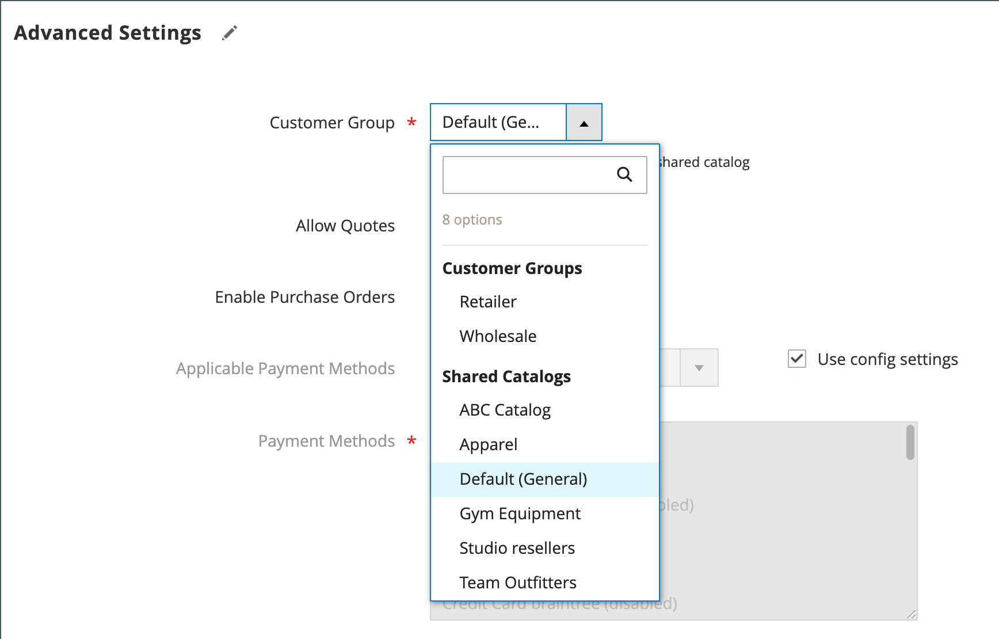

# Affectation d’un groupe de clients à une entreprise

L’affectation d’un groupe de clients à une entreprise est essentiellement identique à l’affectation d’un catalogue partagé. Si le catalogue partagé n’est pas activé [dans la configuration](enable-basic-features.md), un groupe de clients, plutôt qu’un catalogue partagé, est affecté à une entreprise.

- Un seul groupe de clients ou catalogue partagé peut être affecté à une entreprise à la fois. Impossible de supprimer un groupe de clients associé à un catalogue partagé.
- La modification du groupe de clients affecté à la société met à jour les profils de tous les membres de la société.
- Si l&#39;affectation d&#39;un groupe de clients est changée d&#39;un catalogue partagé en un groupe de clients standard, les membres de la société perdent l&#39;accès au catalogue partagé et le catalogue principal devient disponible à partir du storefront.
- Après avoir modifié le groupe de sociétés, un utilisateur de société doit se déconnecter et se connecter au Storefront pour voir les nouveaux prix dans le catalogue.

## Modifier le groupe de clients

1. Dans la barre latérale _Admin_, accédez à **[!UICONTROL Customers]** > **[!UICONTROL Companies]**.

1. Recherchez la société dans la grille et cliquez sur **[!UICONTROL Edit]** dans la colonne _[!UICONTROL Action]_.

   {width="700" zoomable="yes"}

1. Dans la page d’entreprise, faites défiler la page vers le bas et développez  la section **[!UICONTROL Advanced Settings]** .

1. Définissez la **[!UICONTROL Customer Group]** appropriée.

   La liste [!UICONTROL Customer Group] répertorie tous les catalogues partagés existants, même si l’option Catalogues partagés est désactivée dans la configuration.

   {width="600"}

1. Lorsque vous êtes invité à confirmer, cliquez sur **[!UICONTROL Proceed]**.

1. Cliquez sur **[!UICONTROL Save]**.
