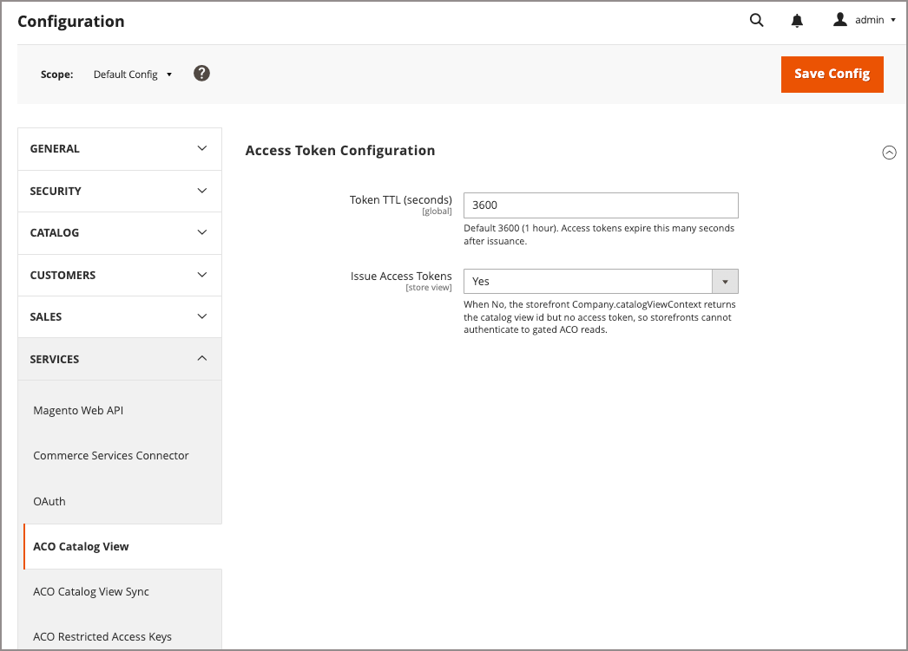

# [!UICONTROL Services] > [!UICONTROL ACO Catalog View]

Utilisez ces paramètres pour contrôler les jetons d’accès émis par le [!DNL Adobe Commerce Optimizer Connector for B2B]. Les storefronts utilisent ces jetons pour s’authentifier sur les vues de catalogue privé Commerce Optimizer renseignées avec des données synchronisées à partir de catalogues partagés personnalisés configurés dans l’administrateur.

>[!NOTE]
>
>Cette page s’applique au connecteur . Les instances configurées avec le modèle de données de catalogue composable (CCDM) synchronisent les données en mode natif et n’utilisent pas le connecteur. Voir [Services de marchandisage avec CCDM](/help/optimizer/overview.md).

{{config}}

<!-- zoom -->

## [!UICONTROL Access Token Configuration]

| Champ | [Portée](../../getting-started/websites-stores-views.md#scope-settings) | Description |
| --- | --- | --- |
| [!UICONTROL Token TTL (seconds)] | Global | Nombre de secondes pendant lesquelles un jeton d’accès reste valide après avoir été généré. Ce paramètre est en lecture seule dans la portée par défaut. Les valeurs configurées sur le site web ou dans la portée de l’affichage du magasin sont ignorées. Valeur par défaut : 3 600 secondes. |
| [!UICONTROL Issue Access Tokens] | Affichage de la boutique | Contrôle si le storefront peut obtenir un jeton d’accès pour une vue de catalogue. Lorsque la valeur est définie sur `No`, `Company.catalogViewContext` renvoie l’ID de vue de catalogue mais aucun jeton d’accès. Par conséquent, les storefronts ne peuvent pas s’authentifier pour lire à partir de [!DNL Adobe Commerce Optimizer] vues de catalogue privé synchronisées à partir d’Adobe Commerce. |

{style="table-layout:auto"}

>[!MORELIKETHIS]
>
> - [Synchronisation des vues de catalogue ACO](./aco-catalog-view-sync.md) — Configurer la manière dont les vues de catalogue sont synchronisées dans [!DNL Adobe Commerce Optimizer]
> - [Surveillance de l&#39;état de synchronisation des vues du catalogue](../../systems/catalog-view-sync-status.md) — Surveillance de l&#39;état de synchronisation et réconciliation de la dérive
