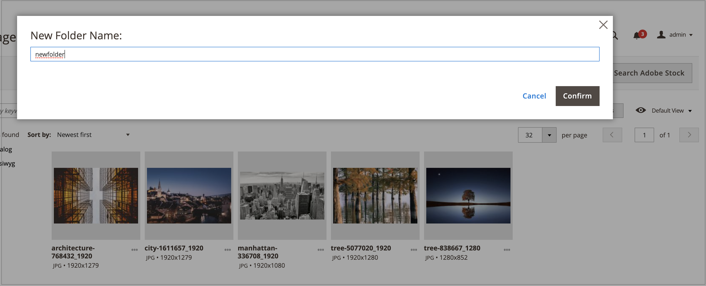
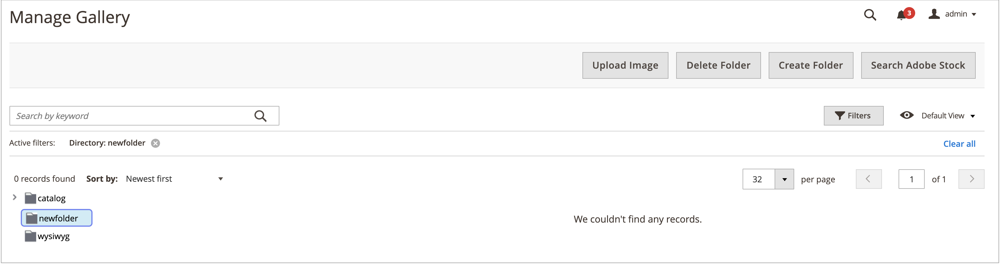

# Gestion des dossiers de Media Gallery

Utilisez des dossiers pour organiser les images dans la nouvelle [&#x200B; Galerie de médias &#x200B;](media-gallery.md). À mesure que le nombre de ressources multimédias augmente, les dossiers facilitent la recherche et la gestion des ressources existantes dans votre galerie de médias.

## Création d’un dossier

Vous pouvez uniquement créer un dossier dans le `pub/media/wysywig`, le `pub/media/catalog/category` ou d’autres dossiers ajoutés par les modules.

1. Dans la barre latérale _Admin_, accédez à **[!UICONTROL Content]** > _[!UICONTROL Media]_>**[!UICONTROL Media Gallery]**.

1. Cliquez sur **[!UICONTROL Create Folder]**.

   Si vous souhaitez créer un sous-dossier, sélectionnez le dossier parent avant de cliquer sur **[!UICONTROL Create Folder]**.

1. Saisissez le nouveau nom de dossier et cliquez sur **[!UICONTROL Confirm]**.

   {width="600" zoomable="yes"}

## Suppression d’un dossier

>[!WARNING]
>
>La suppression d’un dossier entraîne la suppression de toutes les images qu’il contient. Vous pouvez uniquement supprimer un dossier dans les dossiers `pub/media/wysywig` et `pub/media/catalog/category`.

1. Dans la barre latérale _Admin_, accédez à **[!UICONTROL Content]** > _[!UICONTROL Media]_>**[!UICONTROL Media Gallery]**.

1. Sélectionnez le dossier à supprimer.

   {width="600" zoomable="yes"}

1. Cliquez sur **[!UICONTROL Delete Folder]**.

1. Pour confirmer la suppression du dossier, cliquez sur **[!UICONTROL OK]**.
