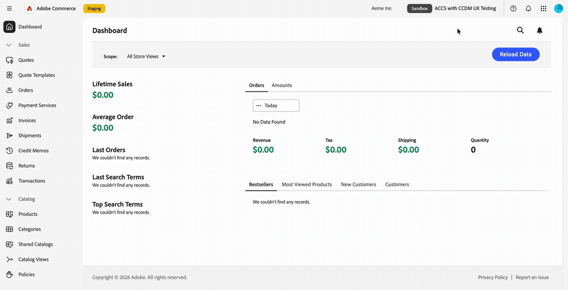
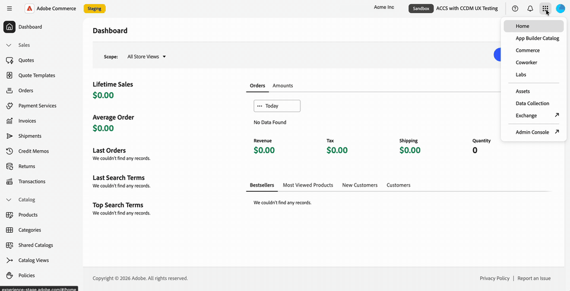
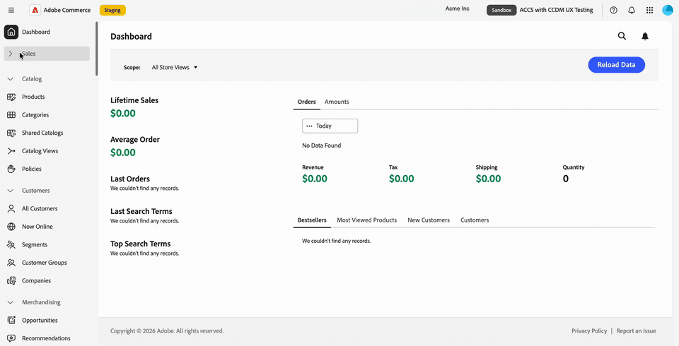

# Administrateur Commerce dans l’expérience unifiée Adobe

Commerce Admin for Adobe Commerce as a Cloud Service s’ouvre dans l’expérience unifiée Adobe lorsque vous sélectionnez un nom d’instance dans Commerce Cloud Manager.

L’interface d’expérience unifiée d’Adobe fournit la navigation supérieure partagée utilisée dans les produits Adobe, une navigation de gauche mise à jour et un style de page d’administration actualisé.

Vous pouvez basculer entre les organisations, les produits et les instances Commerce, et accéder à l’aide, aux notifications et aux préférences du compte à partir du volet de navigation supérieur. Vos autorisations de rôle Commerce existantes continuent de déterminer à quels éléments du menu Admin vous pouvez accéder.

>[!NOTE]
>
>Commerce Admin dans l’expérience unifiée Adobe est disponible uniquement pour Adobe Commerce as a Cloud Service. Les clients Adobe Commerce sur les infrastructures cloud et Adobe Commerce sur site continuent à utiliser l’[IU d’administration Commerce classique](admin.md).

Tableau de bord d’administration Commerce {width="800" zoomable="yes" border="light"}

## Ouvrir l’administrateur Commerce

Après vous être connecté à [Adobe Experience Cloud](https://experience.adobe.com/){target="_blank"}, ouvrez Commerce Cloud Manager. Sélectionnez ensuite une instance pour ouvrir l’Administration dans l’expérience unifiée.

Le flux de connexion vous permet de passer d’une instance Commerce à l’autre sans avoir à vous connecter séparément à chaque instance.
Vous pouvez passer d’une instance Adobe à l’autre sans autre invite de connexion.

Pour la procédure d’accès, voir [Accéder à une instance](https://experienceleague.adobe.com/en/docs/commerce/cloud-service/getting-started#access-an-instance){target="_blank"} dans le _Guide Adobe Commerce as a Cloud Service_.
<!--

>[!BEGINTABS]

>[!TAB Open the Admin from Commerce Cloud Manager]

-->
{width="800" zoomable="yes" border="light"}

<!--
>[!TAB See it in action]

{width="800" zoomable="yes" border="light"}

>[!ENDTABS]

-->

### Choisir une interface d’administration {#classic-ui}

Pour la version initiale de Commerce Admin dans l’expérience unifiée, Adobe Commerce as a Cloud Service prend en charge deux expériences d’administration Commerce, l’expérience unifiée Adobe et l’interface utilisateur classique.

Par défaut, lorsque vous sélectionnez une instance Commerce dans Commerce Cloud Manager, l’administrateur Commerce s’ouvre dans l’expérience unifiée Adobe. Pour revenir à l’interface utilisateur classique, utilisez un signet existant ou recherchez l’URL de l’interface utilisateur classique. Voir [Ouvrir l’interface utilisateur classique](#open-classic-ui).

Les liens pour l’expérience unifiée et l’interface utilisateur classique sont disponibles dans le panneau des détails de l’instance dans Commerce Cloud Manager.

| Lien | Expérience |
| --- | --- |
| **[!UICONTROL Admin URL (Unified Shell UI)]** | Ouvre l’administrateur dans l’expérience unifiée. |
| **[!UICONTROL Admin URL (Classic UI)]** | Ouvre l’interface d’administration précédente. |

{width="800" zoomable="yes" border="light"}

_Illustration basée sur la capture d’écran de la liste des instances et la conception des détails de l’instance mise à jour. Les URL affichées utilisent des hôtes intermédiaires._

#### Formats des URL

| Expérience | Modèle d’URL |
| --- | --- |
| Expérience unifiée | `https://<experience-cloud-host>/#/@<organization>/in:<instance-id>/commerce/cloud-service/admin` |
| Interface utilisateur classique | `https://<commerce-admin-host>/<instance-id>/admin/` |

L’expérience unifiée identifie l’organisation après `@` et l’instance après `in:`. L’interface utilisateur classique place l’ID d’instance directement après le nom d’hôte.

Par exemple, ces URL d’évaluation ouvrent la même instance :

- **Expérience unifiée** : `https://experience-stage.adobe.com/#/@adobe-commerce-uex/in:<instance-id>/commerce/cloud-service/admin`
- **IU classique** : `https://na1-stage.admin.commerce.adobe.com/<instance-id>/admin/`

Ces noms d’hôtes d’évaluation ne sont pas des URL de production. Utilisez toujours les liens de votre instance depuis Commerce Cloud Manager plutôt que de créer des URL.

#### Ouvrir l’interface utilisateur classique

Pour ouvrir l’interface utilisateur classique :

- Utilisez un signet ou une URL d’administration classique existante. Ces URL ouvrent uniquement l’interface utilisateur classique et ne redirigent pas vers l’expérience unifiée.
- Sélectionnez **[!UICONTROL Admin URL (Classic UI)]** dans les détails de l’instance Commerce Cloud Manager.

Il n’y a pas de commutateur d’interface dans l’administrateur. Utilisez Commerce Cloud Manager ou une URL d’administration enregistrée pour revenir à l’interface classique si vous en avez besoin.

## Identifier votre organisation et votre instance

Avant d’apporter des modifications, vérifiez l’organisation et l’instance dans lesquelles vous travaillez :

- Le menu Compte affiche votre organisation actuelle.
- Le sélecteur d’instances dans le volet de navigation supérieur affiche le nom de l’instance et un badge **[!UICONTROL Production]** ou **[!UICONTROL Sandbox]**.

Utilisez le badge d’environnement pour distinguer une instance de production d’un sandbox lorsque vous basculez entre les instances.

## Changement d’organisations, de produits et d’instances

La barre de navigation supérieure fournit des commandes distinctes permettant de changer de contexte de travail.

### Changement d’organisation

Utilisez le sélecteur d’organisation dans le volet de navigation supérieur pour passer d’une organisation à l’autre auquel vous avez accès.

1. Dans le volet de navigation supérieur, sélectionnez le nom de l’organisation.

1. Sélectionnez une organisation dans la liste.

   La liste répertorie les organisations auxquelles vous avez accès. Une coche identifie l’organisation dans laquelle vous travaillez.

>[!BEGINTABS]

>[!TAB Sélecteur d’organisation]

{width="800" zoomable="yes" border="light"}

>[!TAB Voir en action]

{width="800" zoomable="yes" border="light"}

>[!ENDTABS]

Le menu Compte indique également dans quelle organisation vous travaillez. Sélectionnez la photo de votre profil ({width="24"}) dans le volet de navigation supérieur, puis vérifiez la ligne de **[!UICONTROL Organization]**.

{width="800" zoomable="yes" border="light"}

Les instances que vous pouvez ouvrir appartiennent à l’organisation dans laquelle vous travaillez. Pour modifier les instances, voir [Changer d’instance Commerce](#switch-commerce-instances).

### Changer de produits

Utilisez le sélecteur de produits ({width="24"}) dans le volet de navigation supérieur pour modifier les applications à tout moment. Son fonctionnement est le même que dans d’autres produits Adobe.

- **&#x200B;**&#x200B;: ouvrez Adobe Admin Console à partir du sélecteur de produits pour gérer les utilisateurs et leur accès (**[!UICONTROL Administer]** > **[!UICONTROL Users]**). Vous n’avez pas besoin de mémoriser l’URL. Adobe Admin Console est distinct de Commerce Admin, où vous gérez votre boutique.
- **Adobe Exchange** : recherchez des extensions tierces, des modules externes, des scripts et des intégrations d’entreprise dans Adobe Creative Cloud, Adobe Experience Cloud et Adobe Document Cloud.
- **Autres produits** : Ouvrez des produits tels que Coworker.

>[!BEGINTABS]

>[!TAB Menu du sélecteur de produits]

{width="800" zoomable="yes" border="light"}

>[!TAB Voir en action]

{width="800" zoomable="yes" border="light"}

>[!ENDTABS]

Pour la gestion des utilisateurs et des rôles Adobe Commerce as a Cloud Service, voir [Gestion des utilisateurs](https://experienceleague.adobe.com/en/docs/commerce/cloud-service/user-management){target="_blank"}.

### Changement d’instances Commerce

Le volet de navigation supérieur comprend un bouton de sélection d’instances. Il affiche toujours le badge **[!UICONTROL Production]** ou **[!UICONTROL Sandbox]** et le nom de l’instance dans laquelle vous vous trouvez.

1. Dans le volet de navigation supérieur, sélectionnez le sélecteur d’instances qui affiche le nom de votre instance actuelle et votre badge d’environnement.

1. Sélectionnez une instance dans la liste.

   La liste contient les instances Adobe Commerce as a Cloud Service auxquelles vous pouvez accéder dans l’organisation actuelle. Vous n’avez pas besoin de revenir à Commerce Cloud Manager pour changer d’instance, vous pouvez donc passer d’une instance à l’autre.

1. Vérifiez le nom de l’instance et le badge de l’environnement avant de continuer votre travail.

L’instance fait partie de l’URL de la page. Vous pouvez donc ajouter un signet ou partager un lien qui ouvre une instance spécifique. Si vous ouvrez l’Administration sans instance dans le lien, la dernière instance utilisée est chargée.

## Utiliser le volet de navigation de gauche

Le menu Administration de Commerce s’affiche dans le volet de navigation de gauche de l’expérience unifiée Adobe. Développez ou réduisez les sections de menu pour trouver les outils dont vous avez besoin, ou saisissez pour accéder à un élément de menu.

Le menu est spécifique à l’instance dans laquelle vous travaillez. Lorsque vous changez d’instance, le volet de navigation de gauche se met à jour pour correspondre.

Vos autorisations de rôle existantes sont transférées. Seuls les éléments de menu autorisés par votre rôle s’affichent.

Continuez à utiliser le Guide de l’administrateur pour des tâches telles que la gestion des produits, des commandes, des clients et de la configuration. Les pages d’administration ont un style actualisé, de sorte que leur apparence peut différer des captures d’écran de l’interface utilisateur classique de ce guide.

>[!BEGINTABS]

>[!TAB Volet de navigation de gauche de Commerce Admin]

{width="800" zoomable="yes" border="light"}

>[!TAB Voir en action]

{width="800" zoomable="yes" border="light"}

>[!ENDTABS]

## Obtention d’aide et de commentaires

Pour accéder aux ressources sans quitter votre administrateur Commerce, ouvrez le panneau d’aide à l’aide de l’icône d’aide ({width="24"}) dans le volet de navigation supérieur.

- **Aide** : recherchez la documentation d’Adobe Experience League directement à partir du panneau.
- **Assistance** : accédez aux forums de la communauté et à d’autres ressources d’apprentissage, et trouvez vos tickets d’assistance sur Adobe Experience League.
- **Commentaires** : envoyez vos commentaires à Adobe à partir du même panneau.

L’aide, le support et les commentaires sont disponibles dans leur contexte. Vous restez dans votre administrateur Commerce et ne perdez pas votre place.

>[!BEGINTABS]

>[!TAB Panneau Aide]

{width="800" zoomable="yes" border="light"}

>[!TAB Voir en action]

{width="800" zoomable="yes" border="light"}

>[!ENDTABS]

## Affichage des notifications {#view-notifications}

Pour afficher les notifications, les demandes et les annonces de produits en contexte, ouvrez le panneau des notifications à l’aide de l’icône représentant une cloche ({width="24"}) dans la barre de navigation supérieure.

Le panneau rassemble vos **[!UICONTROL Requests]**, **[!UICONTROL Notifications]** et **[!UICONTROL Announcements]** en un seul endroit. Vous n’avez pas besoin de quitter l’administration Commerce pour en voir un seul.

Utilisez l’icône représentant une cloche dans le volet de navigation supérieur de l’expérience unifiée pour ce panneau, plutôt que le contrôle de notification dans l’en-tête de page Commerce. Pour obtenir des instructions sur les messages de la boîte de réception d’administration Commerce, voir [Boîte de réception des messages](admin-message-inbox.md).

>[!BEGINTABS]

>[!TAB Panneau Notifications]

{width="800" zoomable="yes" border="light"}

>[!TAB Voir en action]

{width="800" zoomable="yes" border="light"}

>[!ENDTABS]

## Gérer les préférences du compte

Sélectionnez la photo de votre profil ({width="24"}) dans le volet de navigation supérieur pour ouvrir le menu du compte. À partir de ce menu, vous pouvez :

- Affichez l’organisation dans laquelle vous travaillez.
- Activez le mode sombre avec le bouton (bascule) **[!UICONTROL Dark theme]**.
- Ouvrez vos préférences utilisateur.

>[!BEGINTABS]

>[!TAB Menu Compte en mode sombre]

{width="800" zoomable="yes" border="light"}

>[!TAB Voir en action]

{width="800" zoomable="yes" border="light"}

>[!ENDTABS]

## Mise à jour du style de page.

L’aspect actualisé des pages de l’administration Commerce correspond à l’expérience unifiée Adobe. Une nouvelle mise en forme est prévue pour les versions ultérieures.

>[!MORELIKETHIS]
>
>Guide d&#39;interface et d&#39;administration de [&#128279;](https://experienceleague.adobe.com/en/docs/core-services/interface/experience-cloud)
