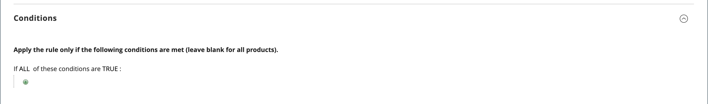
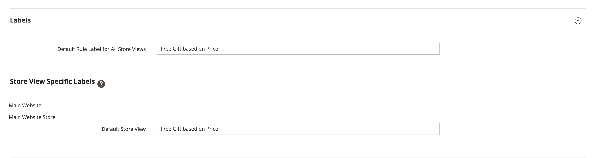

# Promotion cadeau gratuit

La promotion *Cadeau gratuit* vous permet de définir une [ règle de prix de panier](price-rules-cart.md) qui ajoute un article gratuit au panier dans des conditions spécifiques.

>[!NOTE]
>
>Cette fonctionnalité n’est pas prise en charge sur les storefronts Luma. Il est accessible via  et disponible sur les storefronts Edge Delivery Services (EDS).

## Créer une promotion cadeau gratuite

Cette section décrit comment créer une promotion cadeau gratuite en utilisant le format suivant :

**Achetez X produit, obtenez Y produit gratuitement**

1. [Créez une règle de prix de panier](price-rules-cart.md#step-1-add-a-rule) avec une promotion cadeau gratuite.

1. [Décrivez les conditions](price-rules-cart.md#step-2-describe-the-conditions) des instructions du panier pour définir les conditions de la règle de prix. Il s’agit de la première de plusieurs conditions qui peuvent être ajoutées à la règle et qui déterminent à quel moment la règle est déclenchée. Elle peut être basée sur une combinaison des éléments suivants :

   - Attributs de produit
   - Produits
   - Attributs de panier
   - Segments clients Adobe Commerce

   Si rien n’est indiqué, la règle est déclenchée pour chaque panier.

   {width="600" zoomable="yes"}

1. Définissez les actions de la règle de prix de panier :

   1. Développez  (../assets/icon-display-expand.png) la section **[!UICONTROL Actions]** et saisissez les informations suivantes :

   - Définissez **[!UICONTROL Apply]** sur `Free Gift`.
   - Dans **[!UICONTROL Gift SKU(s)]**, sélectionnez un ou plusieurs SKU que le client peut choisir comme cadeau gratuit.
   - Définissez **[!UICONTROL Free Gift Discount Type]** sur **[!UICONTROL Price Based]** ou **[!UICONTROL Discount Based]**.
   - Dans **[!UICONTROL Gift Qty]**, entrez la quantité du cadeau offert au client. Par exemple, saisissez `2` si vous souhaitez que le client reçoive deux articles gratuits.
   - Pour empêcher l&#39;application d&#39;autres remises, **[!UICONTROL Discard subsequent rules]** sur `Yes`.

   1. Cliquez sur **[!UICONTROL Save and Continue Edit]** et effectuez le reste de la règle selon vos besoins.

1. [Complétez le libellé](price-rules-cart.md) des instructions de la règle de prix du panier pour saisir le libellé qui s’affiche lors du passage en caisse.

{width="600" zoomable="yes"}

{{new-price-rule}}

1. Une fois la règle terminée, cliquez sur **[!UICONTROL Save Rule]**.

## Variations

Vous pouvez personnaliser les règles de prix du panier de différentes manières. La fonction Cadeau gratuit peut être configurée avec deux types de remises différents :

- **Basé sur le prix** : un article de ligne cadeau est ajouté au prix de `0`.
- **Basé sur la remise** : une remise complète est appliquée à l’élément de ligne du cadeau.
