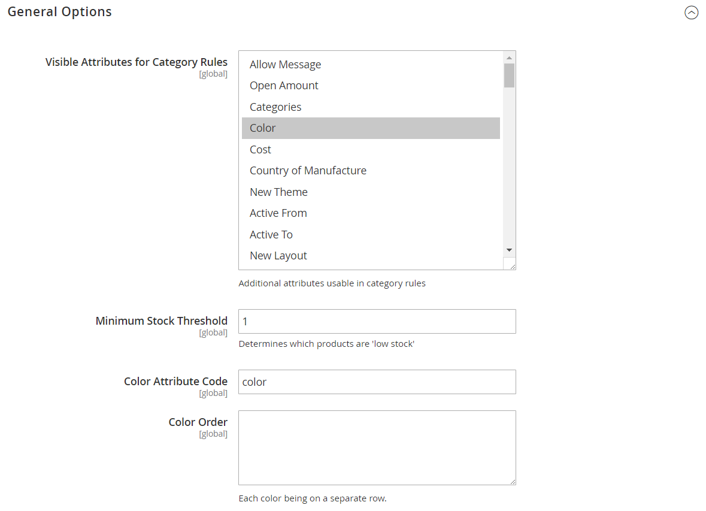

# Configuration des attributs intelligents pour Visual Merchandiser

{{ee-feature}}

La configuration du marchandiseur visuel détermine les attributs qui peuvent être utilisés dans la fenêtre de marchandisage et le seuil de stock minimal. La configuration identifie également l’attribut utilisé pour la couleur et l’ordre des valeurs de couleur.

1. Dans la barre latérale _Admin_, accédez à **[!UICONTROL Stores]** > _[!UICONTROL Settings]_>**[!UICONTROL Configuration]**.

1. Dans le panneau de gauche, développez **[!UICONTROL Catalog]** et choisissez **[!UICONTROL Visual Merchandiser]** en dessous.

1. Développez  la section **[!UICONTROL General Options]** .

   {width="600" zoomable="yes"}

1. Dans la liste **[!UICONTROL Attributes for Category Rules]**, sélectionnez chaque attribut que vous souhaitez rendre disponible pour le marchandisage visuel.

   Pour sélectionner plusieurs attributs, maintenez la touche Ctrl (PC) ou Commande (Mac) enfoncée et cliquez sur chaque élément.

1. Saisissez le **[!UICONTROL Minimum Stock Threshold]** d’affichage d’un produit dans la fenêtre Visual Merchandiser .

1. Saisissez le **[!UICONTROL Color Attribute Code]**.

   La valeur par défaut est `color`. Si votre catalogue utilise un attribut différent, saisissez le nom de l’attribut en minuscules.

1. Par **[!UICONTROL Color Order]**, saisissez chaque valeur de couleur sur une ligne distincte et dans l’ordre pour déterminer la priorité de chaque couleur.

1. Cliquez ensuite sur **[!UICONTROL Save Config]**.
