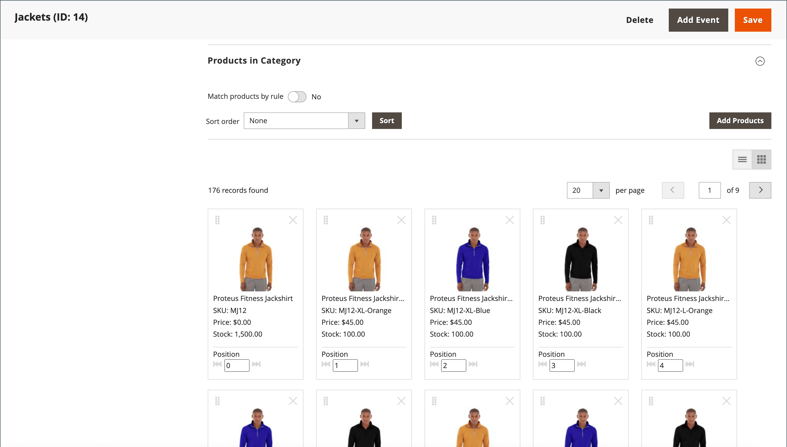
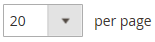

# Marchandiseur visuel

{{ee-feature}}

Le _Marchandiseur visuel_ est un ensemble d’outils avancés qui vous permet de positionner des produits et d’appliquer des conditions qui déterminent quels produits apparaissent dans la liste des catégories. Le résultat peut être une sélection dynamique de produits qui s’adapte aux modifications du catalogue. Vous pouvez travailler en _mode visuel_, qui affiche chaque produit sous la forme d’une mosaïque sur une grille, ou à partir d’une liste de produits de la catégorie. Les mêmes outils sont disponibles dans chaque mode et vous pouvez utiliser les boutons situés dans le coin supérieur droit pour basculer entre chaque type d’affichage.

{width="600" zoomable="yes"}

## Accéder au marchandiseur visuel

1. Dans la barre latérale _Admin_, accédez à **[!UICONTROL Catalog]** > **[!UICONTROL Categories]**.

1. Parcourez l’arborescence des catégories et cliquez sur la catégorie à modifier.

1. Faites défiler vers le bas et développez  la section **[!UICONTROL Products in Category]** .

1. Cliquez sur le bouton _Afficher sous forme de mosaïque_ (  ) pour afficher les produits sous forme de grille.

1. Cliquez ensuite sur **[!UICONTROL Save Category]**.

## Modifier la position d’un produit

1. Utilisez l’[ordre de tri](../catalog/navigation-product-listings.md) pour afficher le produit à déplacer.

   - **Méthode 1 : glisser-déposer**

     Saisissez la commande _Faire glisser_ () dans le coin supérieur droit de la mosaïque du produit et déposez le produit en position. Le numéro de chaque produit s’ajuste pour refléter la nouvelle position.

   - **Méthode 2 : Définir la valeur de la position**

     Dans le contrôleur _Position_ () de la mosaïque du produit, saisissez le numéro où vous souhaitez que le produit apparaisse. Saisissez `0` pour placer le produit en haut de la liste.

1. Cliquez ensuite sur **[!UICONTROL Save Category]**.

>[!NOTE]
>
>Dans une installation propre, Adobe Commerce réserve l’ID de catégorie `2` au catalogue racine du magasin par défaut. Visual Merchandiser ne peut utiliser que des catégories dont le numéro d’ID est supérieur ou égal à `3`.

## Contrôles Workspace

| Contrôle | Description |
|--- |--- |
|  | Afficher comme liste |
|  | Afficher sous forme de mosaïque |
|  | Correspondance par règle - non |
|  | Correspondance par règle - oui |
|  | Faire glisser |
|  | Position |
|  | Supprimer de la catégorie |
|  | Afficher par page |
|  | Aller au suivant/précédent |

{style="table-layout:auto"}
