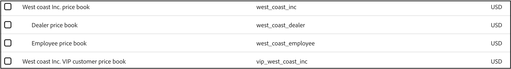

# Catalogues de prix

Les livres de prix définissent les prix des produits pour une source de catalogue sur plusieurs niveaux de client et marchés. Ils prennent en charge une hiérarchie de livres de prix parents et enfants.

## Concepts clés

| Terme | Description |
| ------ | ------------- |
| **Catalogue De Prix** | Regroupement logique qui définit les prix d’une source de catalogue, par exemple une région spécifique ou le niveau client, et qui est utilisé pour gérer les prix des produits. |
| **Tarif de secours** | Classement des prix le plus élevé dans une hiérarchie. Il n&#39;a pas de parent et est le catalogue de prix *uniquement* qui définit la devise pour lui-même et tous ses catalogues de prix descendants.  Si aucun parent n&#39;est défini lors de la création du catalogue de prix (via l&#39;API), un nouveau catalogue de prix de secours est créé. |
| **Catalogue de prix parent** | Un catalogue de prix de niveau supérieur à partir duquel un catalogue de prix enfant peut hériter des prix s&#39;ils ne sont pas explicitement définis dans le catalogue enfant. |
| **Profondeur De Hiérarchie** | Maximum de trois niveaux (de secours -> enfant -> petit-enfant)  non appliqué au moment de l&#39;ingestion. |
| **Devise** | Défini pour le catalogue de prix de secours uniquement. Hérité par tous les livres de prix enfants.  Si la devise n&#39;est pas spécifiée lors de la création du catalogue de prix de secours (via l&#39;API), la devise par défaut est USD. |
| **Prix du produit** | Prix spécifique attribué à un produit (SKU) dans un catalogue de prix particulier. |
| **Remises** | Les remises sont définies dans le prix du produit. Non hérité. |

## Mise en œuvre du catalogue des prix

Lors de l’utilisation d’Adobe Commerce as a Cloud Service avec le modèle de données de catalogue composable (CCDM), les tarifs sont mappés à partir des données de catalogue et de tarification. Ils ne sont pas créés manuellement.

À un niveau élevé, le mappage est le suivant :

- **Affichage du magasin → source du catalogue** : les données de produit d’affichage du magasin, y compris les attributs localisés, sont mappées à une source du catalogue.
- **Catalogue de prix ou catalogue de prix du site Web →**—Le catalogue de prix du site Web est mappé au catalogue de prix ou aux catalogues de prix applicables.
- **Comptabilisation des groupes de clients → Entrées du catalogue des prix**—La tarification des groupes de clients est mise en correspondance avec les entrées de prix pertinentes.

Mettez à jour le catalogue source, le site web et la configuration de tarification dans la configuration d&#39;Adobe Commerce, puis affectez les tarifs mappés dans la vue de catalogue appropriée en configurant les tarifs disponibles. Si aucun catalogue n&#39;est affecté, la vue catalogue utilise le catalogue des prix par défaut.

Une vue de catalogue utilise la configuration des tarifs disponibles avec ses données de catalogue et ses politiques pour déterminer l’expérience de marchandisage, y compris les prix renvoyés pour les produits.

>[!NOTE]
>
>Pour Commerce B2B, le système crée et attribue un seul catalogue à chaque vue de catalogue en fonction de la configuration de catalogue partagée. Vous n’avez pas besoin de configurer la disponibilité du catalogue des prix pour ces vues.

## Prix de passage en caisse

Les tarifs prennent en charge l’expérience de catalogue de marchandisage et de storefront. Commerce Core continue de gérer le panier et le passage en caisse. Un prix disponible uniquement dans le CCDM ne devient pas automatiquement le prix utilisé par le passage en caisse.

Conservez la cohérence des prix avec la configuration principale de Commerce et testez les prix affichés, l’ajout au panier, les promotions et le passage en caisse dans le cadre de la validation de l’implémentation.

## Afficher les registres des prix

Une fois la synchronisation des données du catalogue terminée, affichez les tarifs disponibles et leurs identifiants dans l’espace de travail **[!UICONTROL Catalog views]**.

1. Accédez à _Configuration du magasin_, puis cliquez sur **[!UICONTROL Catalog views]**.

1. Cliquez sur **[!UICONTROL Create catalog view]**.

1. Passez en revue les tarifs disponibles dans la section **[!UICONTROL Price Books]** de la configuration de la vue de catalogue.

   

## Configurer la disponibilité du catalogue des prix

Associez des tarifs catalogue mappés à des vues de catalogue en configurant les tarifs disponibles dans l’espace de travail des vues de catalogue dans l’administrateur Commerce.

>[!NOTE]
>
>Une vue de catalogue privée (une avec [!UICONTROL Catalog Protection] activé) ne peut référencer qu’un seul catalogue de prix.

1. Dans l’espace de travail **[!UICONTROL Catalog views]**, sélectionnez la vue de catalogue que vous souhaitez configurer.

1. Dans la section **[!UICONTROL Price Books]**, sélectionnez les catalogues de prix disponibles pour les magasins pris en charge par la vue Catalogue.
