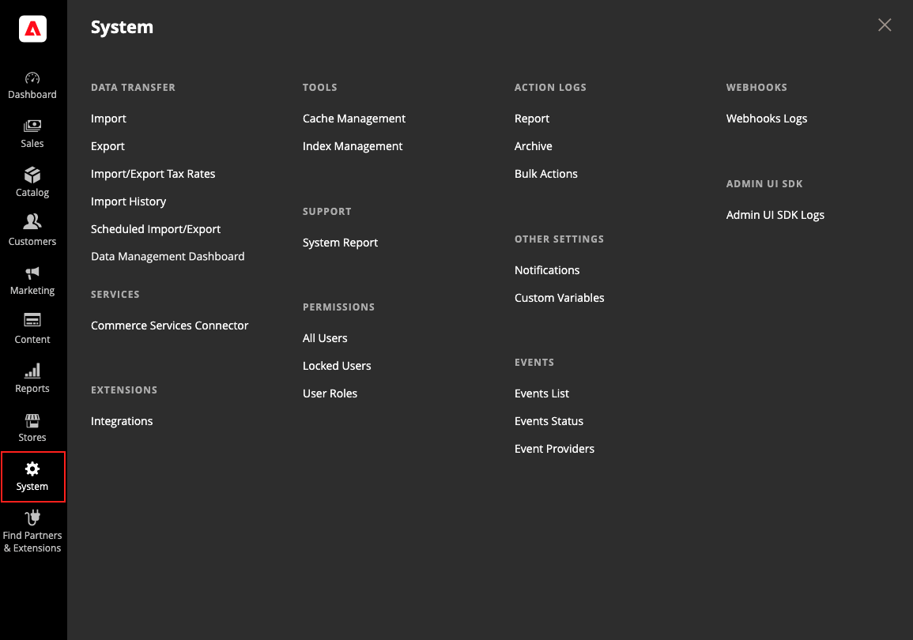
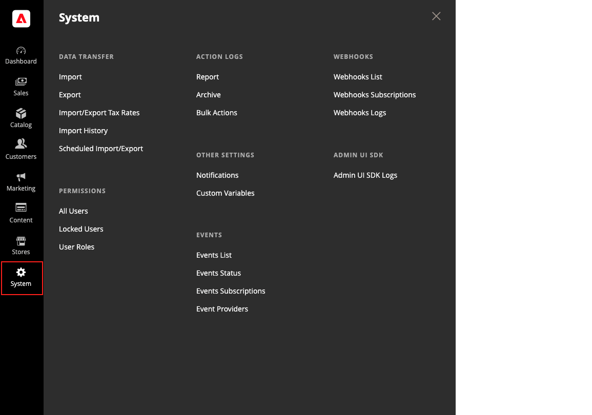

# Menu [!UICONTROL System]

Le menu [!UICONTROL System] comprend des outils permettant d&#39;importer et d&#39;exporter des données, de gérer les caches et les index système, de gérer les autorisations, les sauvegardes, les notifications système et les variables personnalisées.

>[!BEGINTABS]

>[!TAB Adobe Commerce]

[!BADGE PaaS uniquement]{type=Informative url="https://experienceleague.adobe.com/fr/docs/commerce/user-guides/product-solutions" tooltip="S’applique uniquement aux projets Adobe Commerce on Cloud (infrastructure PaaS gérée par Adobe) et aux projets On-premise."}

{width="600" zoomable="yes"}

>[!TAB Adobe Commerce as a Cloud Service]

[!BADGE SaaS uniquement]{type=Positive url="https://experienceleague.adobe.com/fr/docs/commerce/user-guides/product-solutions" tooltip="S’applique uniquement aux projets Adobe Commerce as a Cloud Service et Adobe Commerce Optimizer (infrastructure SaaS gérée par Adobe)."}

{width="600" zoomable="yes"}

>[!ENDTABS]

{{ccdm-merchandising-note}}

**_Pour afficher le menu [!UICONTROL System]:_**

Dans la barre latérale _Admin_, cliquez sur **[!UICONTROL System]**.

## [!UICONTROL Data Transfer]

Ces [outils](data-transfer.md) vous offrent la possibilité de gérer plusieurs enregistrements en une seule opération. Vous pouvez importer de nouveaux articles, ainsi que mettre à jour, remplacer et supprimer des produits et des taux de taxe existants.

## [!UICONTROL Extensions]

[!BADGE PaaS uniquement]{type=Informative url="https://experienceleague.adobe.com/fr/docs/commerce/user-guides/product-solutions" tooltip="S’applique uniquement aux projets Adobe Commerce on Cloud (infrastructure PaaS gérée par Adobe) et aux projets On-premise."}

Gérez les [intégrations et extensions tierces](integrations.md) pour votre boutique.

## [!UICONTROL Tools]

[!BADGE PaaS uniquement]{type=Informative url="https://experienceleague.adobe.com/fr/docs/commerce/user-guides/product-solutions" tooltip="S’applique uniquement aux projets Adobe Commerce on Cloud (infrastructure PaaS gérée par Adobe) et aux projets On-premise."}

Utilisez cette collection d’outils pour gérer vos ressources système, notamment la gestion du [cache](cache-management.md) et de l’[index](index-management.md), les [sauvegardes](backups.md) et les paramètres d’installation.

## [!UICONTROL Support]

[!BADGE PaaS uniquement]{type=Informative url="https://experienceleague.adobe.com/fr/docs/commerce/user-guides/product-solutions" tooltip="S’applique uniquement aux projets Adobe Commerce on Cloud (infrastructure PaaS gérée par Adobe) et aux projets On-premise."}

 (Adobe Commerce uniquement)

Les [outils d’assistance](support.md) peuvent être utilisés comme ressource pendant les processus de développement et d’optimisation, et comme outil de diagnostic pour aider notre équipe d’assistance à identifier et à résoudre les problèmes liés à votre système.

## [!UICONTROL Permissions]

Adobe Commerce et Magento Open Source utilisent [les rôles et autorisations](permissions.md) pour créer différents niveaux d’accès pour les utilisateurs administrateurs. Ces outils permettent aux administrateurs d&#39;accorder des autorisations sur la base du _besoin de savoir_ aux personnes qui travaillent sur votre site.

## [!UICONTROL Action Log]

 (Adobe Commerce uniquement)

Le [journal des actions](action-log.md) suit les activités des administrateurs qui travaillent dans votre magasin. Pour la plupart des événements, les informations disponibles incluent l’action, le nom de l’utilisateur, s’il s’agit d’un succès ou d’un échec, et l’identifiant de l’objet qui était la cible de l’action. L’archive des actions d’administration répertorie les fichiers journaux CSV stockés sur le serveur.

## [!UICONTROL Other Settings]

Gérez les [notifications](notifications.md) dans votre boîte de réception, créez [des variables personnalisées](variables-custom.md) et générez une nouvelle [clé de chiffrement](encryption-key.md).
